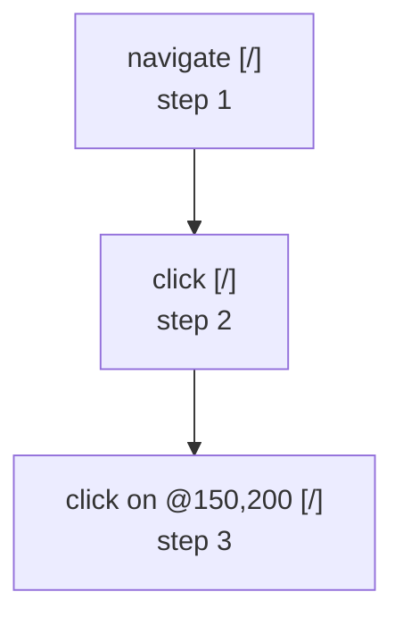

# DAG Action Graph

## Node Legend

| ID | Signature | First Seen |
|-----|-----------|------------|
| N0 | `http://localhost:4173/\|navigate\|\|none` | step 1 |
| N1 | `http://localhost:4173/\|click\|\|none` | step 2 |
| N2 | `http://localhost:4173/\|click\|\|@150,200` | step 3 |
